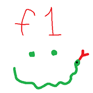
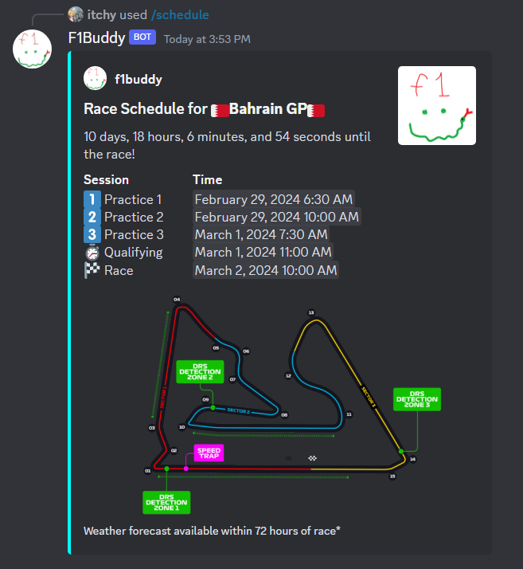
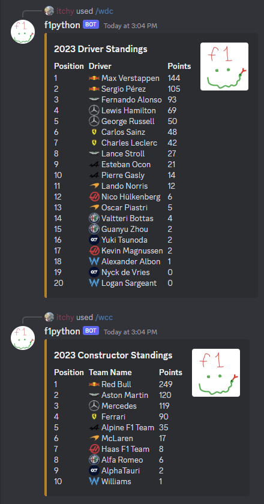
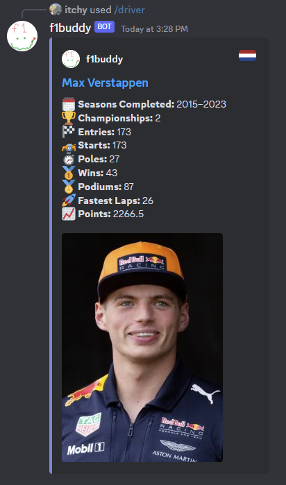
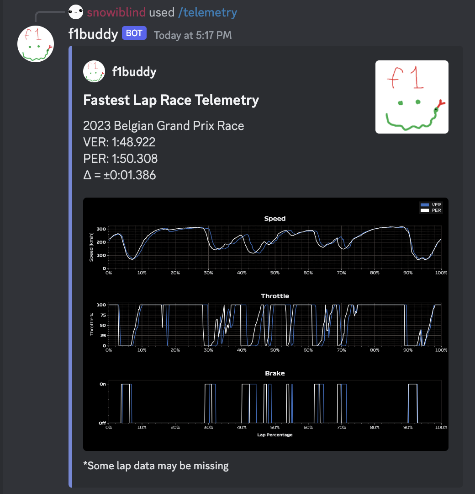
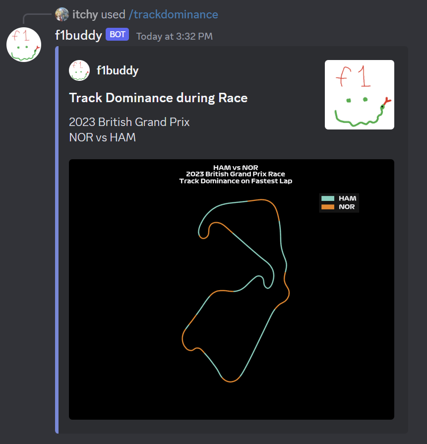
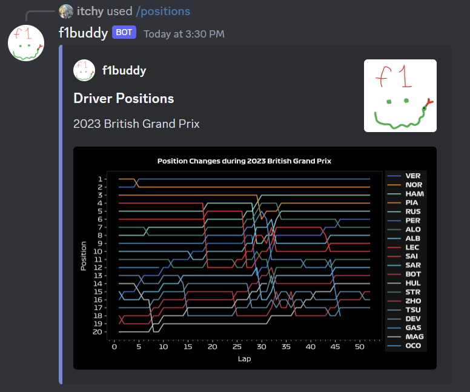

# f1buddy

A Discord bot for Formula 1: schedules, standings, results, telemetry plots, FIA documents, session reminders and a predictions game.

This is a ground-up rewrite of the original bot. Every old command is still here, the scrapers that kept breaking are gone, and the whole thing can be tested without a Discord token.

## Commands

**Information**

| Command | What it does |
|---|---|
| `/schedule` | Next race weekend: sessions in your local time, circuit map, weather within 72 hours |
| `/wdc`, `/wcc` | Driver and constructor standings for any season |
| `/constructors` | A season's teams, with nationality and titles won |
| `/driver` | Career summary for any driver in F1 history |
| `/results`, `/qualifying` | Race and qualifying classification |
| `/fl` | Fastest race lap for one round, or every round of a season |
| `/live` | Recap of the most recent session, and when the next one starts |
| `/lightsout` | Reaction-time game |
| `/help` | Lists the commands, or explains one |

**Plots** (2018 onwards unless noted)

| Command | What it does |
|---|---|
| `/laptimes` | Two drivers' lap times across a race |
| `/positions` | Every driver's position on every lap |
| `/strategy` | Tyre stints for every driver |
| `/qualigap` | Each driver's gap to pole |
| `/consistency` | How consistent one driver's race pace was |
| `/telemetry` | Speed, throttle and brake traces for one or two drivers, with an optional AI analysis |
| `/trackdominance` | Which of two drivers was faster on each part of the track |
| `/avgpos` | Average finishing or qualifying position over a season (1950 onwards) |
| `/h2h` | Teammate head-to-head record over a season (1950 onwards) |

**FIA documents**

| Command | What it does |
|---|---|
| `/fiadoc` | Shows a recent FIA document as images |
| `/setup fia` | Posts every new FIA document to a channel automatically |

**Reminders and weekend posts**

| Command | What it does |
|---|---|
| `/remindme` | DMs you before sessions start |
| `/setup reminders` | Posts a reminder in a channel before sessions, optionally mentioning a role |
| `/setup weekend` | Posts the weekend preview, results and standings to a channel automatically |

**Predictions**

| Command | What it does |
|---|---|
| `/predict pole` | Predict the pole-sitter; locks when qualifying starts |
| `/predict podium` | Predict the top three; locks when the race starts |
| `/predictions` | See a race's predictions, and the scores once it's run |
| `/leaderboard` | Season leaderboard for the server |
| `/predictions-rescore` | Recompute a race's scores after a late penalty (admins) |

Scoring: 5 points for pole, 5 for each podium driver in the right position, 2 for a podium driver in the wrong position, and a 5-point bonus for a perfect podium.

`/setup` commands and `/predictions-rescore` need the Manage Server permission.

<details><summary><b>Previews</b></summary>

Schedule | Standings | Driver
:---:|:---:|:---:
 |  | 

Telemetry | Track dominance | Position changes
:---:|:---:|:---:
 |  | 

These screenshots are from the original bot; the rewrite keeps the same layouts.

</details>

## Running it

You need Docker and a Discord bot token.

1. **Create the bot** in the [Discord Developer Portal](https://discord.com/developers/applications). Under *Bot*, turn on the **Message Content Intent** (it is only used for the `f1$sync` command below). Leave the other two privileged intents off.
2. **Configure it:** copy `.env.example` to `.env` and fill in `DISCORD_TOKEN`. `ADMIN_USER_IDS` already lists the two bot admins.
3. **Start it**, either from the published image or from source:
   ```bash
   # published image (replace yourname with the Docker Hub account)
   F1BUDDY_IMAGE=yourname/f1buddy:latest docker compose up -d

   # or build from source
   docker compose up -d --build
   ```
4. **Invite the bot** to a server with the `bot` and `applications.commands` scopes and these permissions: Send Messages, Embed Links, Attach Files, Add Reactions and Read Message History.
5. **Publish the slash commands.** An admin types `f1$sync` in any channel the bot can read. Do this once, and again whenever commands change.
6. **Set up the automatic features** you want, per server: `/setup fia`, `/setup reminders`, `/setup weekend`.

Logs: `docker compose logs -f`. All state (database, caches) lives in the `f1buddy-data` volume, so it survives updates.

Run only one copy of the bot per token. Two copies answer every command twice.

### Deploying as a Komodo stack

1. Create a stack and point it at this repository (branch `main`), or paste in `docker-compose.yaml`.
2. In the stack's **Environment**, add the variables from `.env.example`, plus `F1BUDDY_IMAGE=yourname/f1buddy:latest`. Komodo writes these to `.env` beside the compose file, which is where the container reads them from.
3. Deploy. To update later, redeploy with "pull images" enabled.

### Publishing the image

Every push to `main` runs the tests and, if they pass, publishes `<DOCKERHUB_USERNAME>/f1buddy:latest` to Docker Hub (`.github/workflows/docker-publish.yml`). A tag such as `v2.0.0` publishes that version as well. The workflow needs two repository secrets: `DOCKERHUB_USERNAME` and `DOCKERHUB_TOKEN` (a Docker Hub access token with write access).

### Configuration

| Variable | Required | Purpose |
|---|---|---|
| `DISCORD_TOKEN` | yes | Bot token |
| `ADMIN_USER_IDS` | yes | Comma-separated user ids allowed to run `f1$sync` |
| `OWNER_ALERT_CHANNEL_ID` | no | Channel for operational alerts, such as the FIA page no longer parsing |
| `FIA_CHANNEL_ID` | no | Channel for automatic FIA documents; same as running `/setup fia` there |
| `GEMINI_API_KEY` | no | Turns on the AI analysis option of `/telemetry` |
| `GEMINI_MODEL` | no | Model for that analysis (default `gemini-2.5-flash`) |
| `LOG_LEVEL` | no | Default `INFO` |
| `DATA_DIR` | no | Where the database and caches live (`/data` in Docker, `./data` otherwise) |

### Optional extras

- **Team and tyre emojis.** Put the images in `f1buddy/assets/emojis/`, named after the team id (`red_bull.png`, `ferrari.png`) or tyre (`tyre_soft.png`), then run `DISCORD_TOKEN=... python scripts/upload_emojis.py`. Without them, embeds simply have no emojis.
- **Warm the cache** so the first users don't wait for downloads:
  ```bash
  docker compose run --rm f1buddy python scripts/warm_cache.py 2026
  ```
  This also draws the circuit maps for `/schedule`.

## Development

```bash
python -m venv .venv
.venv/bin/pip install -r requirements-dev.txt     # Windows: .venv\Scripts\pip
.venv/bin/python -m pytest                         # offline, no token needed
.venv/bin/python -m pytest -m live                 # canaries against the real services
```

The offline tests replace every external service, so they run in a few seconds with no network. The `live` canaries check that each real service still returns what the bot expects; run them when something looks wrong.

`python scripts/smoke.py info` and `python scripts/smoke.py plots` run the commands against real data and print the embeds or save the plots to `data/smoke/`.

To run the bot without Docker: set the variables from `.env.example` in your environment and run `python -m f1buddy`.

### How it's put together

```
f1buddy/
  sources/   one module per external service; the only code that touches the network
  data/      pure functions: source data in, plain dataclasses out
  render/    dataclasses in, Discord embeds or PNG bytes out
  cogs/      thin command handlers
  series/    the schedule interface, so other series can be added later
specs/       the specifications this was built from, with decisions and known differences
```

The specs in `specs/` describe every command's behaviour and acceptance criteria. `specs/legacy-inventory.md` records what the original bot did.

### Data sources

| Source | Used for |
|---|---|
| [FastF1](https://github.com/theOehrly/Fast-F1) | Schedule, results, laps, telemetry |
| [Jolpica](https://github.com/jolpica/jolpica-f1) | Standings, constructors, career statistics, season results |
| [Open-Meteo](https://open-meteo.com) | Weather forecast |
| [OpenF1](https://openf1.org) | Session recap for `/live` |
| Wikipedia | Driver photos |
| fia.com | FIA documents (the only page that is scraped) |

### When the FIA site changes

FIA documents are the one feature that reads a web page. If the page changes shape, the bot posts an alert to `OWNER_ALERT_CHANNEL_ID` and `pytest -m live` fails. To fix it:

1. Save the new page as `tests/fixtures/fia/landing.html`.
2. Edit `parse_listing` in `f1buddy/sources/fia.py` until `pytest tests/test_fia.py` passes.

Nothing else needs to change.

## Known limitations

- **`/live` is a recap, not live timing.** Live data needs a paid source. During a session the command says so and shows the recap afterwards.
- **`/avgpos` "Mechanical only" is approximate for recent seasons.** The results data now labels every retirement "Retired", so the cause is unknown from about 2024 onwards.
- **`/driver` fastest-lap counts start in 2004**, when that data begins.
- **A circuit new to the calendar has no map** on `/schedule` until it has been raced once.
- **Lap and telemetry plots start in 2018**, when the timing data begins.

## Credits

Originally built by Rakib, Anurag and Jubayer. F1 fonts and team logos belong to their owners; this project is not affiliated with Formula 1 or the FIA.
